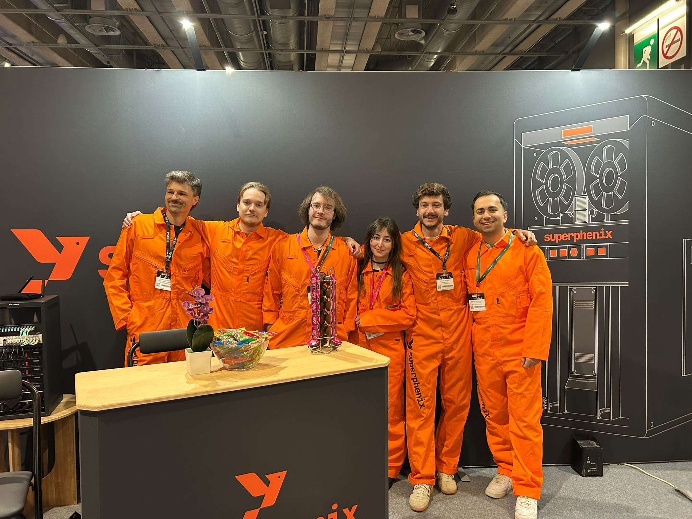
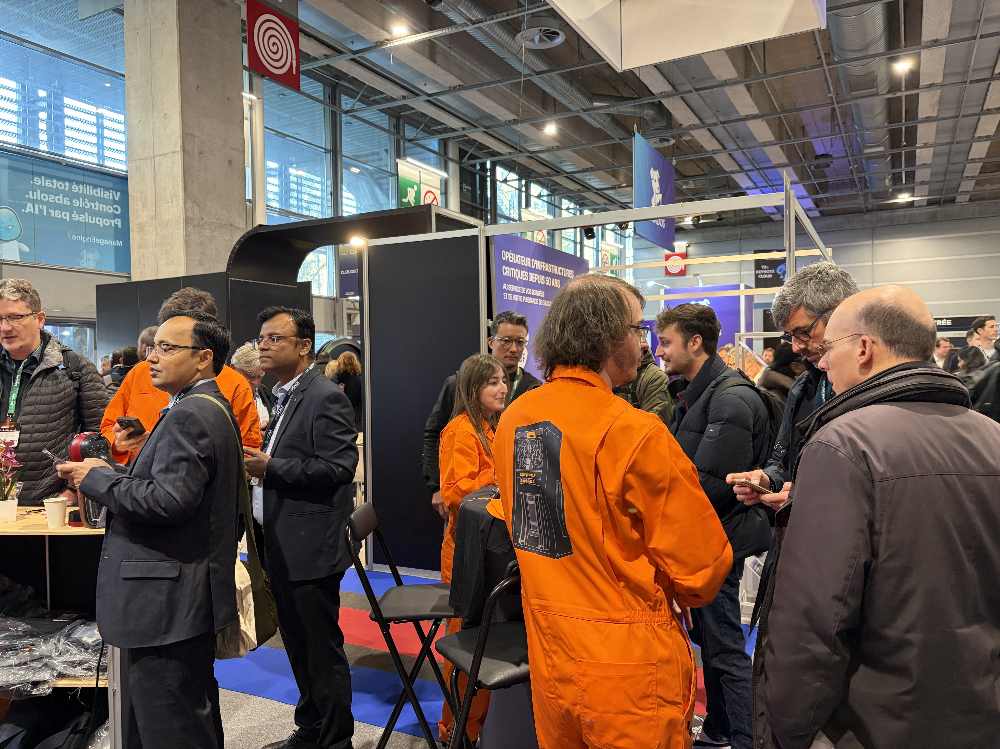
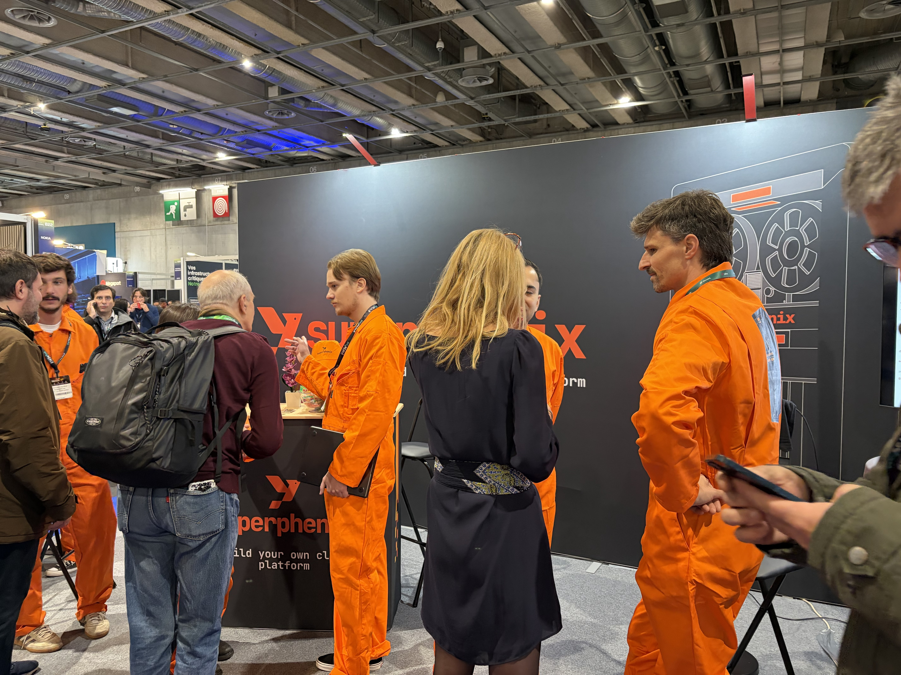
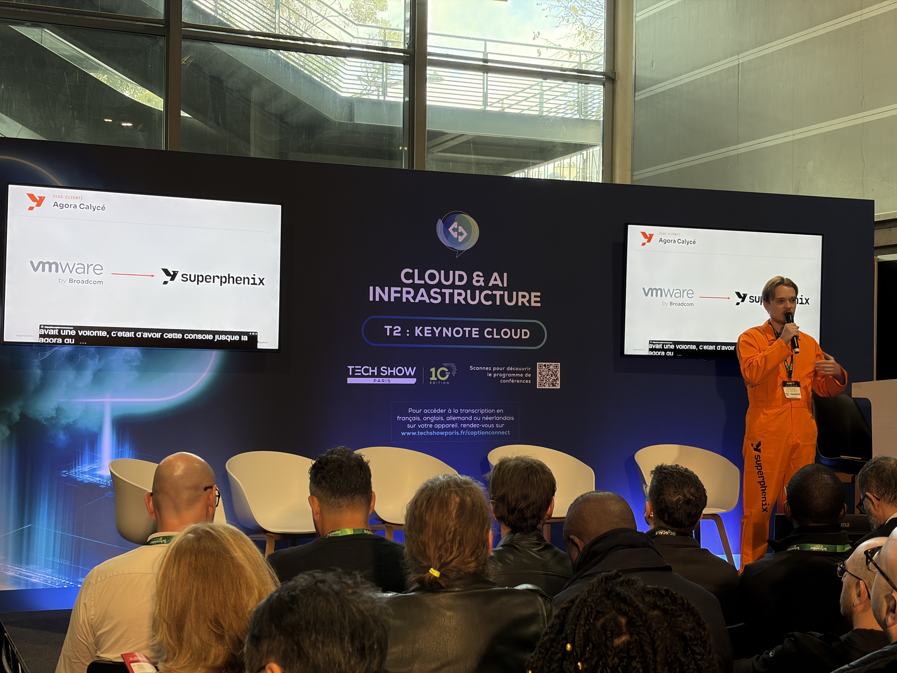
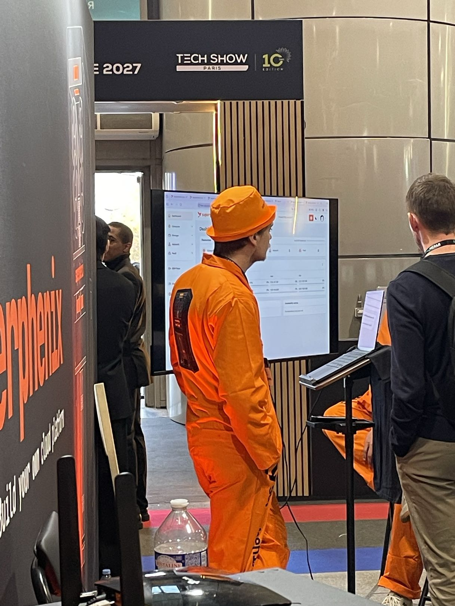

# Superphenix at Tech Show Paris

The Rayshift team spent November 18 and 19, 2026 at **Tech Show Paris**, at Paris Expo Porte de Versailles. It was the largest show we had done. Hundreds of visitors came by, and the booth stayed full both days. The orange coveralls made us easy to find from across the hall.

If you don't know what [Rayshift](https://rayshift.net) is, we're the company that created Superphenix and we offer enterprise support for it !

People wanted to talk about moving off VMware, about infrastructure that spans more than one datacenter, and about GPUs and inference. We were there to show Superphenix, an open-source project for running your own cloud provider on your own infrastructure. [Agora Calycé](why-we-created-superphenix.md), where the project started, was on the stand with us.

On November 18 we had 25 minutes on the Cloud keynote stage. The session was "Superphenix: Your 100% open-source private cloud, running on your infrastructure." We used it to explain what the project is. The feedback was strongly positive, and it showed that the project has a real place as this market keeps changing.

At the booth, a screen showed the Superphenix console, so visitors could look at the product up close.

To try it, start with [Getting started](../../installation/getting-started.md). [Rayshift](../../enterprise-support.md) also provides enterprise support for teams taking it to production.

Thanks to everyone on the stand and to our many visitors ! We'll see you soon for more events !
