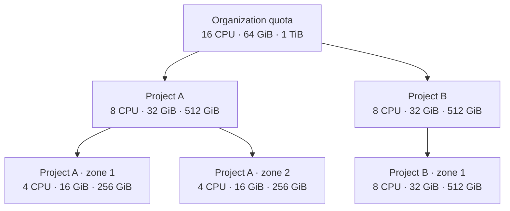

# Quotas

A **quota** is the pool of CPU, memory, and disk an organization may consume. A platform administrator sets the organization quota. An organization **Admin** or **Owner** splits that pool across projects, then across the availability zones where each project runs. The zone admits the project's Instances, Disks, and other products only while they fit in that share.

To give an organization its pool, follow [Add an organization quota](../../operations/adding-an-organization-quota.md).

## How the pool is split {#how-the-pool-is-split}

The numbers below are an example of an equal split. They are not a default. Each box lists CPU, memory, and disk, in that order. The organization pool of 16 CPU, 64 GiB of memory, and 1 TiB of disk is divided across two projects. Project A is divided again across two zones. Project B keeps its whole share in one zone. At every level, the children add up to the parent.

| Level | Who sets it | What it bounds |
|-------|-------------|----------------|
| Organization | A platform administrator | The sum of what the organization's projects hold |
| Project | An organization **Admin** or **Owner** | The sum of that project's availability-zone quotas |
| Availability zone | A project **Admin** | What the project may run in that zone |

A parent quota cannot be set below what its children already hold. Lower the availability-zone quotas, then the project quotas, then the organization quota. A child cannot grow past what its parent still has left.

The first time you set an organization quota, and no project of that organization has a project quota yet, the platform divides the pool across the live projects. A project that already has availability-zone quotas receives at least the sum of those quotas. What remains is split equally. Each new project share is then split equally across the availability zones that organization can see. An availability zone that already has its own quota keeps it.

When projects already have project quotas, those quotas stay as they are. The organization quota has to cover them.

Removing the organization quota leaves the project quotas in place, and those project quotas stay enforced.

## Resources

A quota names up to three resources. Each value is a quantity: a count of CPUs, or a size of memory or disk.

| Resource | What it limits | Examples |
|----------|----------------|----------|
| `cpu` | CPU the project may use in the zone | `16`, `1500m` (one and a half CPUs) |
| `memory` | Memory the project may use in the zone | `64Gi` |
| `disk` | Disk the project may request in the zone | `1Ti` |

Any other name is rejected. A negative quantity is rejected.

A resource left out of a quota is unlimited at that level. A resource present as `"0"` is a hard limit of zero. A resource an ancestor limits, and this level does not mention, is treated as `0`.

## Where a quota applies {#where-a-quota-applies}

After a quota is saved, each availability zone enforces the share for that project. A new project in an organization that already has a quota starts at zero on every resource the organization limits, until the project receives a project quota.

A quota that GitOps already manages for a project in a zone stays as GitOps wrote it. The platform does not replace it.

!!! warning "Quotas are a beta feature"
    An Instance, or any other product the project runs, that does not say how much CPU or memory it may use is refused while a CPU or memory quota is in place. This holds true for system resources (Kubernetes controlplanes, databases). Some features may not schedule due to quotas. This will be fixed in futur updates.

## Permissions

A platform administrator sets the organization pool through the admin API. That call does not use the permissions below. Reading the pool, and splitting it across projects and zones, does.

Every call also requires `OrganizationRead`.

| Permission | Grants | Held by |
|------------|--------|---------|
| `OrganizationProjectQuotaRead` | Read the organization quota and each project's share | Organization owner, `ProjectQuotaFullAccess`, `ProjectQuotaReadOnly` |
| `OrganizationProjectQuotaWrite` | Set or remove a project quota | Organization owner, `ProjectQuotaFullAccess` |
| `ProjectAZQuotaRead` | Read one project's quota and the share of each zone | Organization owner, `ProjectQuotaFullAccess`, `ProjectQuotaReadOnly`, `ProjectAZQuotaFullAccess`, `ProjectAZQuotaReadOnly` |
| `ProjectAZQuotaWrite` | Set the share of one availability zone | Organization owner, `ProjectAZQuotaFullAccess` |

`ProjectQuotaFullAccess` and `ProjectQuotaReadOnly` are permission sets on the organization. `ProjectAZQuotaFullAccess` and `ProjectAZQuotaReadOnly` are permission sets on the project. Attach them to IAM groups.

The predefined **Owner** group holds every quota permission. **Admin** ships with `ProjectQuotaFullAccess` and `ProjectAZQuotaFullAccess`, so it can split the pool and set each zone. **Developer** ships with `ProjectQuotaReadOnly` and `ProjectAZQuotaReadOnly`. **Billing** ships with none of these sets.
