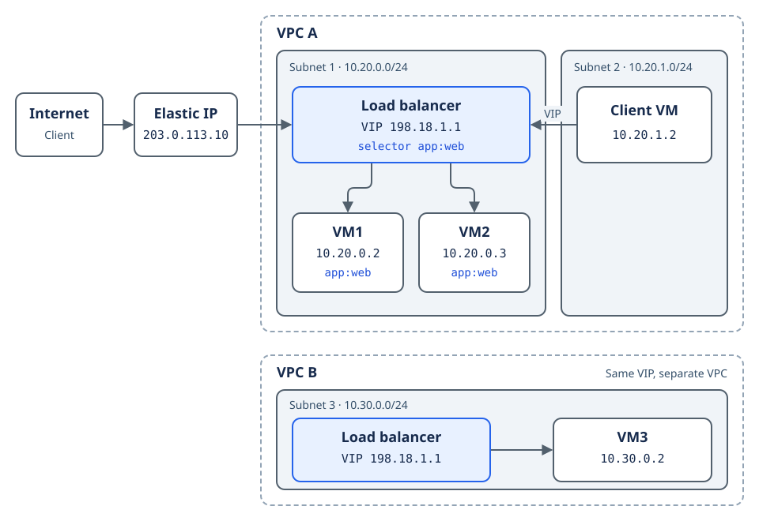

# Load Balancer

A **Load Balancer** is a Layer 3/Layer 4 (TCP/UDP) reverse proxy and traffic distributor. It exposes a dedicated **Virtual IP (VIP)** within an Availability Zone (AZ) and forwards incoming connections to pools of backend VMs or pods using **TCP**, **UDP**, or **SCTP** (protocol availability may vary by release). Listeners can reference **named ports** for clarity in larger configs.

## Subnet and VPC

Every load balancer takes a **subnet** when you create it. The platform pins the load balancer to that subnet and to the **VPC** that owns the subnet.

- Pick a subnet of a VPC you own or that is shared with your project.- Any VM in the VPC reaches the VIP, whatever its subnet, as long as the VPC routes between the subnets.
- The subnet cannot change after creation. To move a load balancer to another subnet, delete it and create it again.
- Health check **source** addresses come from this subnet.
- To reach the load balancer from the Internet, map an [Elastic IP](eip.md) to its VIP. The subnet needs a NAT gateway.

## Virtual IP range

- You choose the front **virtual IP** from **`198.18.0.0/16`** (IPv4 only at the time of writing).
- A VIP is **unique within a VPC**. The platform checks every load balancer of the AZ and rejects a second one on the same VIP with an error.
- Two load balancers in **different VPCs** can use the same VIP.

## Mapping (backends)

**Mapping** defines where traffic is sent:

| Mode               | Behavior                                                                                      |
| ------------------ | --------------------------------------------------------------------------------------------- |
| **IP backends**    | Target backends by **raw IP** (static list).                                                  |
| **Label backends** | Target VMs matching a **label selector**; backends update **dynamically** when new VMs match. |

You then define **ports** (for example **80** / **443**) for forwarding.

**Health checks** probe backends; failing members are removed.

!!! warning "Backends must sit in the load balancer's subnet"

    Every backend must be in the subnet you chose for the load balancer. The platform refuses endpoints and matching VMs from any other subnet. Only the **first network interface** of each VM participates in load balancing: **secondary NICs** are not used.
---

## Backend Pool Strategies

### Dynamic Selector Mode (`type: Selector`)
- Discovers backends automatically using workload labels (e.g., `app=web`, `role=api`).
- When new VMs or pods are created or terminated with matching labels, the load balancer updates its backend routing table without manual reconfiguration.
- Recommended for auto-scaling workloads and microservices.

### Static Endpoint Mode (`type: Endpoint`)
- Routes traffic to an explicit list of private IPv4 addresses.
- Useful for legacy systems, fixed-IP instances, or external appliances that do not use platform workload labels.

---

## Port Rules and Protocols

Each Load Balancer supports multiple independent port mapping rules:

| Property     | Value          | Description                                              |
| :----------- | :------------- | :------------------------------------------------------- |
| `port`       | 1–65535        | Ingress listening port exposed on the VIP.               |
| `targetPort` | 1–65535        | Destination port listening on backend instances or pods. |
| `protocol`   | `TCP` \| `UDP` | Layer 4 transport protocol.                              |

### Session Affinity
When session affinity is enabled, incoming connections from the same client IP address are consistently routed to the same backend member for the duration of the affinity window.

---

## Operational Constraints

- **AZ Scoping**: The Virtual IP and its target backends must reside within the same Availability Zone.
- **Pinned subnet**: A load balancer keeps the subnet it was created with. Updates cannot change it.
- **Earlier load balancers**: Load balancers created before subnet pinning keep running and you can delete them. An update returns an error until you delete the load balancer and create it again with a subnet. Their VIPs still count toward the uniqueness check.
- **Cluster Locks**: Load balancers created and managed by Kubernetes-as-a-Service (KaaS) clusters (such as Ingress controller LBs) are protected against destructive manual modifications in the console.
- **GitOps Tracking**: Load Balancers managed declaratively display synchronization status and links to their associated ArgoCD applications.

For a step-by-step walkthrough, see [Create a load balancer](../../user-guides/network/create-a-load-balancer.md).
