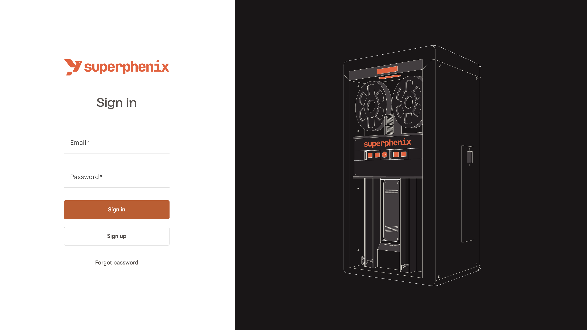
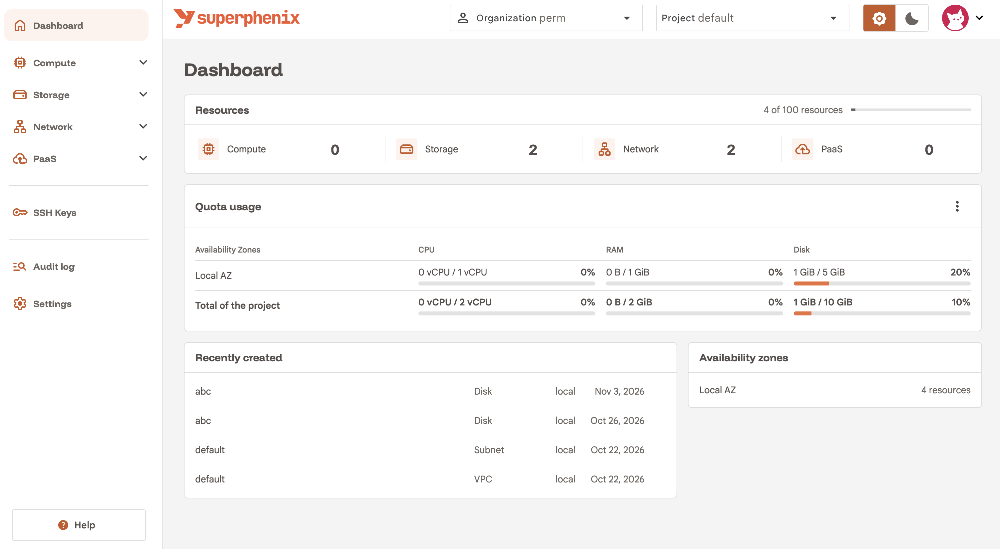
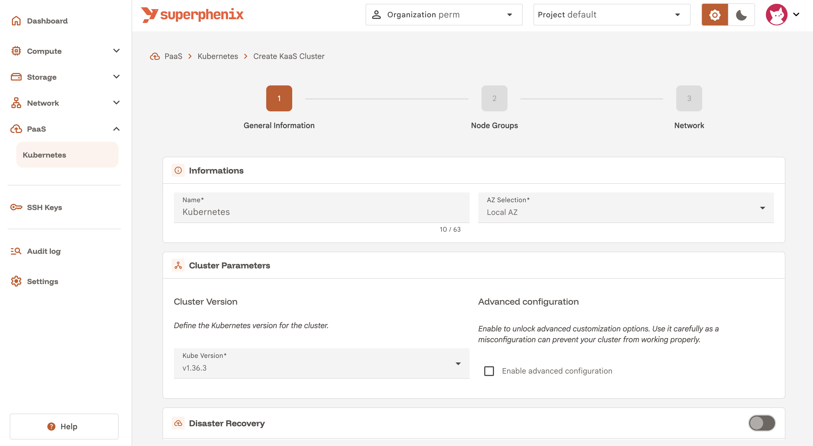
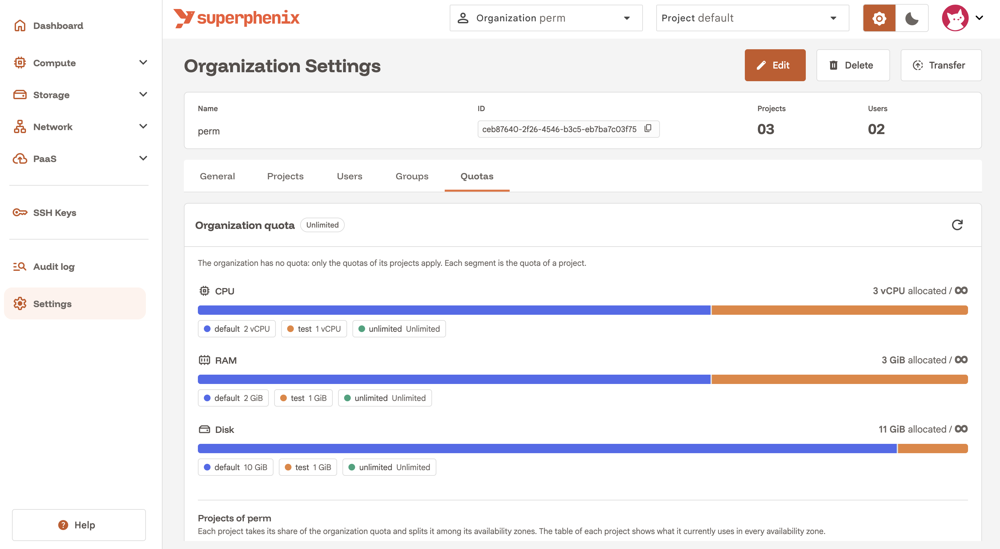

# Build your own cloud platform with Superphenix

{ .index-logo }

**Superphenix** (SPX) is an open-source, **cloud-native** project to build a **Cloud Service Provider (CSP)** on your own infrastructure using **Kubernetes**.

It turns Kubernetes into a platform capable of handling **virtual machines, networking, storage, and software** in the same way cloud providers do. A CSP delivers on-demand compute, storage, and applications across **IaaS**, **PaaS**, and **SaaS**. Superphenix covers those layers so you can offer **resilient**, **high-availability**, **high-performance** services from your own datacenters, grouped into **availability zones** and **regions**.

To install a first cluster, see [Getting started](installation/getting-started.md). For complete and advanced deployment paths, see the [deployment guide](installation/deployment-guide/index.md).

<figure class="spx-carousel__slide" markdown="1" role="group" aria-roledescription="slide" aria-label="1 of 4">

</figure>

<figure class="spx-carousel__slide" markdown="1" role="group" aria-roledescription="slide" aria-label="2 of 4">

</figure>

<figure class="spx-carousel__slide" markdown="1" role="group" aria-roledescription="slide" aria-label="3 of 4">

</figure>

<figure class="spx-carousel__slide" markdown="1" role="group" aria-roledescription="slide" aria-label="4 of 4">

</figure>

<button type="button" class="spx-carousel__nav spx-carousel__nav--prev" data-carousel-prev aria-controls="spx-home-carousel" aria-label="Previous screenshot"><svg viewBox="0 0 24 24" width="26" height="26" aria-hidden="true" focusable="false"><path d="M14.5 5.25 8 11.75l6.5 6.5" fill="none" stroke="currentColor" stroke-width="1.6" stroke-linecap="round" stroke-linejoin="round"/></svg></button>
<button type="button" class="spx-carousel__nav spx-carousel__nav--next" data-carousel-next aria-controls="spx-home-carousel" aria-label="Next screenshot"><svg viewBox="0 0 24 24" width="26" height="26" aria-hidden="true" focusable="false"><path d="M9.5 5.25 16 11.75l-6.5 6.5" fill="none" stroke="currentColor" stroke-width="1.6" stroke-linecap="round" stroke-linejoin="round"/></svg></button>

## About the name

The project is named **Superphenix** (SPX) after the [Superphénix](https://en.wikipedia.org/wiki/Superph%C3%A9nix) nuclear power plant in France. The name is a nod to building something ambitious and innovative on open, sovereign infrastructure. We spell the project Superphenix (without the accent) so it works on all keyboard layouts.

## What Superphenix offers

- **Hypervisor**: VMs, live migration, snapshots, workload scheduling and load balancing
- **Storage**: Block, file (*Soon*) and S3 storage with replication and disaster recovery
- **Software-defined network**: VPCs, NAT gateways, BGP, load balancers, QoS, firewalling
- **PaaS**: Kubernetes as a Service
- **SaaS**: Databases (*Soon*), Inference as a Service (*Soon*)
- **GitOps**: Installs, upgrades, and resource provisioning via GitOps
- **Web Console**: Multi-tenant console to manage multiple AZs from one place
- **Backup and disaster recovery**: Cross-AZ mirroring, disk, VM and metadata backups, automated disaster recovery

For more detail, see [Features](features/index.md).

## Who Superphenix is for

- **At scale**: Build a cloud platform across **multiple datacenters and regions**. Deploy several AZs, group them into regions, mirror data and backups between AZs, and operate everything from a single interface.
- **Single datacenter**: Run one or more AZs in **one datacenter**. Ideal for MSPs, enterprises, or labs that want a full CSP stack without multi-site complexity.
- **Single rack**: Run in a **single rack** for small actors, labs, or even **at home**. Evaluate the stack, learn the platform, or host a small private cloud on minimal hardware.

If you need **independence** and **total control** of your infrastructure for **SaaS, PaaS and IaaS**, Superphenix should cover most of your use cases.

## Philosophy

Superphenix was initially built at a **cloud service provider** that wanted more control over its own infrastructure, without having to rely on **proprietary** software and hardware with expensive licenses.

That is why the project aims to provide all the features a CSP needs to serve its customers with the **highest level** of availability and redundancy. Superphenix is designed to be deployed across multiple **datacenters** spread geographically over multiple **continents**.

The project authors chose to make it **open source** because we believe it can benefit **organizations of all sizes** that want to build their own cloud platform.

## Why Kubernetes?

Kubernetes is a container orchestrator, not a VM orchestrator. Using it as the core of a **cloud-native** CSP brings:

- **Automation**: Declarative APIs, GitOps, and a single control plane
- **Unified operations**: Same tooling for scheduling, monitoring, and upgrades
- **Ecosystem**: **CNI** and **CSI** plugins and operators from the **CNCF** ecosystem already solve many integration problems
- **Expertise**: Teams that already run Kubernetes can operate the CSP stack with the same mindset

The trade-off is adapting Kubernetes to VMs, storage, and CSP-style networking. Superphenix does that by combining a multitude of **open source projects** into one coherent, cloud-native platform.

## Do I need to know Kubernetes?

You **do not** need extensive Kubernetes knowledge to use Superphenix. But you **do need** Kubernetes/Talos knowledge to install and operate Superphenix.

At this stage of the project, Kubernetes experience is still necessary. Debugging Superphenix or doing advanced deployments requires knowledge of Kubernetes and Talos.

We hope that in the future, we can abstract Kubernetes as much as possible.

## Quick links

- [**Features**](features/index.md): Virtualization, network, storage, and tooling
- [**Getting started**](installation/getting-started.md): Install a first lab cluster
- [**Deployment guide**](installation/deployment-guide/index.md): All installation modes and operating patterns
