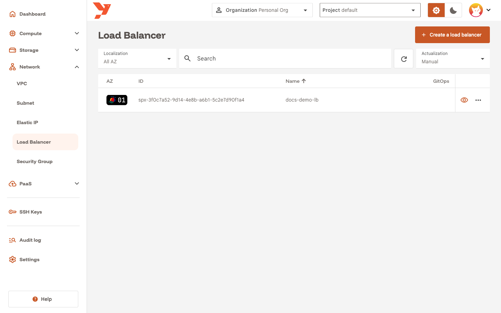
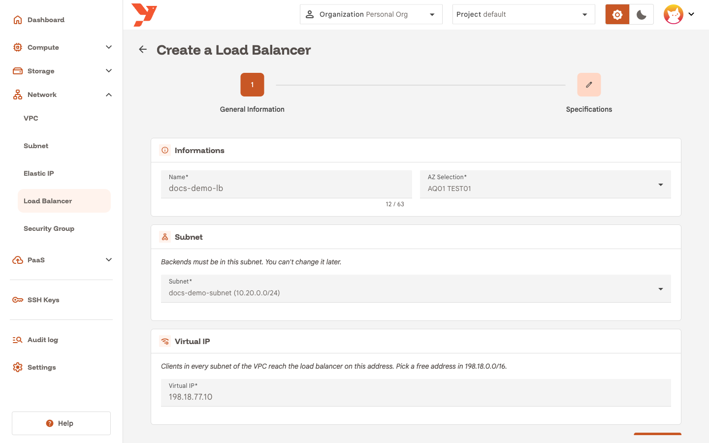
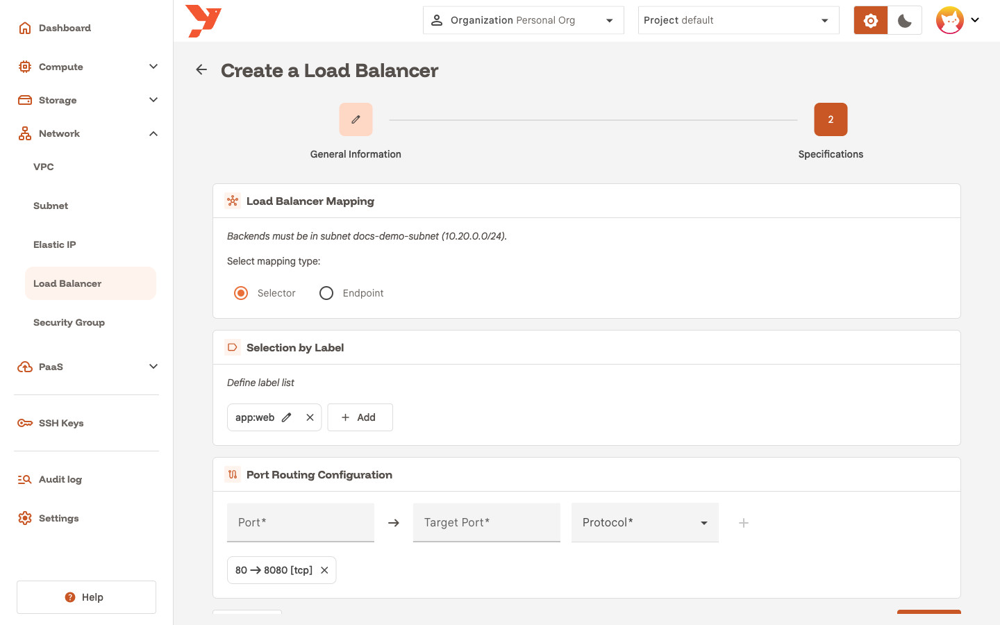
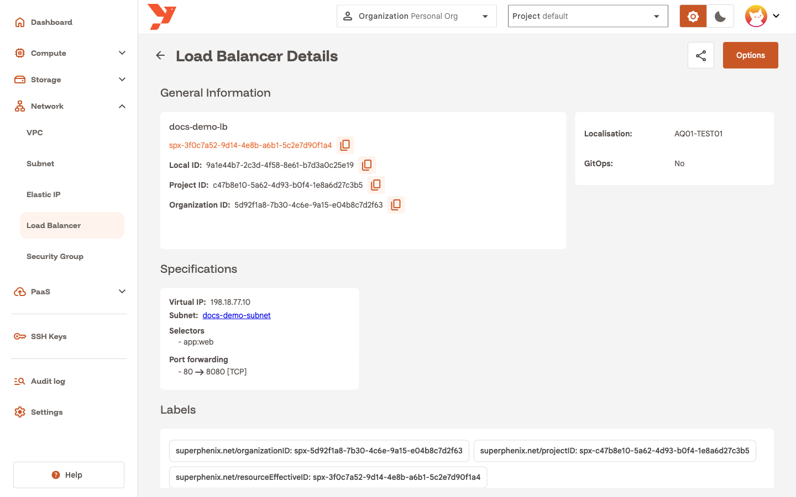
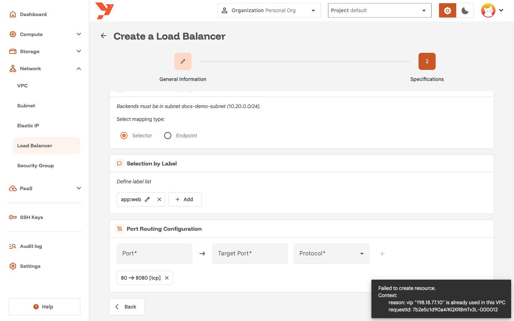

# Create a load balancer

A load balancer gives a group of VMs one Virtual IP (VIP) and spreads TCP or UDP connections across them. It lives in one AZ and attaches to one subnet. This guide creates `docs-demo-lb` on port 80 for the VMs that carry the label `app:web`.

For the concepts behind VIPs, backends and health checks, read [Load Balancer](../../features/network/load-balancer.md).

## Before you start

- Select your organization and project in the top bar.
- Have a subnet in a VPC of your own. The load balancer pins itself to that subnet and to its VPC, and you cannot change either later. The subnet list in the wizard shows the subnets of the AZ you pick. [Create a subnet with a NAT gateway](create-a-subnet.md) walks through creating one. The guide uses `docs-demo-subnet`, `10.20.0.0/24`.
- Put the backend VMs in that same subnet. The console refuses an endpoint outside the subnet, and a selector that matches a VM in another subnet.
- Choose a VIP from `198.18.0.0/16` that no other load balancer of the VPC uses. The guide uses `198.18.77.10`.

## Open the wizard

1. In the sidenav, open **Network** and click **Load Balancer**.
2. Click **Create a load balancer**.



The wizard has two steps: **General Information** and **Specifications**.

## Step 1: General Information

1. Enter a **Name**, for example `docs-demo-lb`.
2. Pick the AZ in **AZ Selection**. The subnet list fills with the subnets of that AZ.
3. Pick `docs-demo-subnet` in **Subnet**.
4. Enter the VIP in **Virtual IP**, for example `198.18.77.10`.
5. Click **Next**.



!!! note
    Clients in every subnet of the VPC reach the VIP. The subnet only decides where the backends live and where health checks come from.

## Step 2: Specifications

The first card names the subnet again: **Backends must be in subnet `docs-demo-subnet`**. Choose how the load balancer finds its backends.

| Mapping type | Use it when |
|--------------|-------------|
| **Selector** | The backends are VMs you tag with labels. New VMs that match join the load balancer, and VMs that stop matching leave it. |
| **Endpoint** | The backends have fixed IPv4 addresses. Every address must belong to the subnet. |

1. Keep **Selector**. Click **Add** in the **Selection by Label** card, type `app:web` and click **Add** in the dialog. The label must match the labels on your VMs, prefix included.
2. In **Port Routing Configuration**, enter `80` in **Port** and `8080` in **Target Port**, keep **Protocol** on `TCP`, and click the **+** button. The rule shows as `80 → 8080 [tcp]`. Add one rule per port you publish.
3. Click **Create**.



With **Endpoint**, you add one IPv4 address per backend instead of a label.

## Read the details page

The console opens the details page. The **Specifications** card shows the **Virtual IP**, the **Subnet** the load balancer is pinned to, the **Selectors** and the **Port forwarding** rules.



## Test the connection

From a VM in the same VPC, send a request to the VIP:

```bash
curl http://198.18.77.10
```

The request lands on a backend VM, on port 8080.

## If the VIP is taken

A VIP is unique within a VPC. When another load balancer of the VPC already uses it, the console refuses to create yours and shows the reason.



Pick another address from `198.18.0.0/16` and click **Create** again. Load balancers in different VPCs can share a VIP.

## Change or delete a load balancer

- You can edit the selector, the endpoints and the port rules from the **Options** menu of the details page. The subnet is read-only.
- To move a load balancer to another subnet, delete it and create it again.
- A load balancer created before subnet pinning keeps running and you can delete it. Updating one returns an error. Delete it and recreate it with a subnet.
